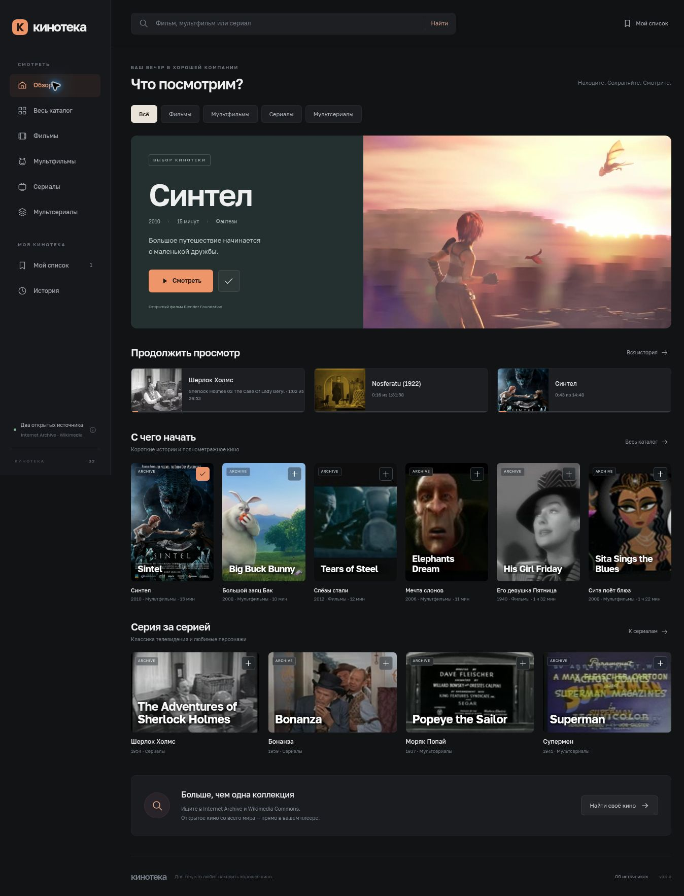

# Kino · Кинотека v0.3.0

Приложение для поиска и просмотра открытого кино. Репозиторий: https://github.com/stepkadid/Kino .

Веб-приложение для поиска и просмотра кино с открытой лицензией. Статическое приложение на HTML/CSS и ES modules, без API-ключей и зависимостей на этапе сборки.



## Новые источники v0.3.0

Сайт: https://stepkadid.github.io/Kino/

- PeerTube / SepiaSearch: поиск и встраиваемый плеер. Список фильмов не ограничен домашней подборкой.
- RUTUBE: встроенный плеер по публичной ссылке; попытка поиска через публичный API. API сейчас отклоняет запросы из проверяемой среды, поэтому автопоиск не считается работающим и ошибка показывается явно.
- VK Видео, YouTube, Vimeo: плееры по ссылке или официальному коду вставки. Автопоиск по этим платформам не подключён: VK требует пользовательской авторизации API, YouTube — API-ключа, Vimeo — соответствующего доступа API. Приватные токены не хранятся на GitHub Pages.
- Dailymotion: API поиска доступен, но актуальный встраиваемый плеер требует Player ID из Dailymotion Studio. Автопоиск Dailymotion включается после ввода публичного Player ID в настройках. Записи без встроенного плеера не выдаются как готовые к просмотру.
- Для незнакомых сайтов, включая LordFilm, не угадываются адреса и API: нужна конкретная ссылка и проверка способа подключения.

Блок переходов на поиск других площадок удалён по просьбе пользователя. Доступные видео воспроизводятся внутри приложения. Для добавления публичного видео — кнопка «По ссылке»; оно сохраняется в личный список.

Внешний iframe не даёт приложению прочитать точную позицию видео. История таких видео хранит факт открытия, а качество и управление остаются в плеере источника. Запуск iframe не считается подтверждением доступности конкретного фильма: внутри него может появиться ограничение площадки.

Фильтр по умолчанию скрывает очевидные трейлеры, обзоры, музыку и игровые записи; результаты проверяются на совпадение названия. Запрос «киберпанк» уточняется как Cyberpunk Edgerunners. Это исправление релевантности, а не обещание наличия сериала: при проверке подтверждённой полной доступной серии в подключённых API не найдено.

## Возможности

- Реальный поиск в Internet Archive и Wikimedia Commons, выбор источника, сортировка и постраничная загрузка.
- Фильмы, мультфильмы, сериалы и мультсериалы; классификация по метаданным. В домашней подборке 10 записей, поиск ими не ограничен.
- Обложки из источников, локальные изображения для подборки и SVG-заглушка при сбое загрузки. Обложкой может быть кадр видео.
- Для русских запросов: словарь распространённых названий и поиск оригинального названия через Wikipedia. При отсутствии перевода остаётся русский запрос.
- Карточки с описанием, авторством, лицензией и ссылкой на источник. Видеофайлы проверяются при открытии карточки.
- Плеер с реальными разрешениями файлов, переключением качества с сохранением позиции и состояния паузы, скоростью 0.75–2×, перемоткой, громкостью, fullscreen и Picture-in-Picture, если браузер поддерживает.
- Автоматический выбор доступной версии до 720 пикселей высотой при первом запуске, затем запоминание выбранной высоты. Это не адаптивный HLS/DASH: версия переключается вручную между прямыми файлами.
- Список серий, запуск конкретной серии, следующая серия и настраиваемое автоматическое продолжение.
- Мой список, история и продолжение просмотра сохраняются в localStorage этого браузера. Данные первой версии мигрируют автоматически.
- Отмена устаревших запросов, задержка поиска при наборе, тайм-ауты, кэш результатов и независимые статусы источников. Запрос и фильтры сохраняются в URL.
- Адаптивный интерфейс, мобильная навигация, доступные имена элементов и клавиши Space/←/→/F/M в плеере вне элементов ввода.

## Запуск

```sh
python3 -m http.server 8000 --directory dist
```

Откройте http://localhost:8000. ES modules требуют HTTP, открывать index.html через file:// не следует.

```sh
npm run check
npm test
```

Установка npm-пакетов не нужна. `.github/workflows/pages.yml` проверяет проект и публикует `dist` при push в main. Для GitHub Pages в настройках репозитория нужно выбрать источник GitHub Actions. После включения GitHub Pages workflow публикует новую версию автоматически при изменении main. Откройте Settings → Pages → Build and deployment → Source → GitHub Actions. Если Pages недоступен для приватного репозитория на вашем тарифе, нужен публичный репозиторий или GitHub Pro.

## Источники

- Search: https://archive.org/advancedsearch.php , Metadata: https://archive.org/metadata/{identifier} . Поиск ограничен коллекциями feature_films, animationandcartoons, classic_tv и записями с указанной CC или Public Domain. После поиска URL лицензии проверяется, при открытии — повторно.
- Wikimedia Commons MediaWiki API: https://commons.wikimedia.org/w/api.php . `videoinfo` возвращает атрибуцию, лицензию, производные видео и обложку. Поиск исключает по названию трейлеры, тизеры и отрывки, а также видео короче четырёх минут. Неполные записи всё же возможны.
- Для перевода русского названия: https://ru.wikipedia.org/w/api.php .

Внешние APIs вызываются из браузера с их поддержкой CORS. Нет стороннего CORS-прокси, ключей или ретрансляции видеотрафика через приложение. Каталог не гарантирует наличие любого фильма или современной премьеры. Метки лицензий предоставлены источниками, а общественное достояние зависит от юрисдикции. Поиск не обходит подписки и ограничения доступа. Русская дорожка и субтитры не добавляются автоматически.

Качество выводится по `height`, а не по тексту имени файла. Например, производная `tears_of_steel_1080p.mp4` имеет высоту 360 и отображается как 360p. У широкоформатных фильмов фактическая высота может быть 818 или 872 пикселя. Если есть только одна версия, показывается только она. Неподдерживаемые форматы отфильтрованы через canPlayType. Для двух явно связанных фильмов Blender добавляются версии Commons, если длительность совпадает с точностью до 3 секунд.

## Авторство изображений и подборки

Изображения в `dist/assets` — постер или кадры соответствующих фильмов из их записей Internet Archive. `sintel-hero.jpg` — кадр Sintel на 5:06, извлечённый из полного файла; изображение обрезается только при отображении. Оригинальные титры в видео сохранены.

- Sintel: © Blender Foundation / www.sintel.org, CC BY 3.0. https://durian.blender.org/sharing/
- Big Buck Bunny: © 2008 Blender Foundation / www.bigbuckbunny.org, CC BY 3.0. https://peach.blender.org/about/
- Tears of Steel: © Blender Foundation / mango.blender.org, CC BY 3.0. https://mango.blender.org/about/
- Elephants Dream: Blender Foundation / Orange Open Movie Project, CC BY 3.0, согласно записи https://archive.org/details/ElephantsDream .
- Sita Sings the Blues: Nina Paley, CC0 согласно https://archive.org/details/Sita_Sings_the_Blues .
- His Girl Friday: Columbia Pictures; источник маркирует Public Domain: https://archive.org/details/his_girl_friday .
- Sherlock Holmes (1954): Guild Films; источник маркирует Public Domain: https://archive.org/details/SherlockHolmes1954 .
- Bonanza: NBC; только доступные в этой записи серии, источник маркирует Public Domain: https://archive.org/details/Bonanza_pd .
- Popeye: Fleischer / Famous Studios; подборка пяти мультфильмов из https://archive.org/details/MorePopeyeCartoons , Public Domain по данным источника. В подборке есть серии разных лет.
- Superman (1941): Fleischer Studios, один эпизод из https://archive.org/details/superman_1941 , Public Domain по данным источника.

Авторство и лицензия каждой внешней записи показываются в карточке и под плеером. Логотипы Blender не используются. Иконки приложения и запасная обложка выполнены в SVG.
